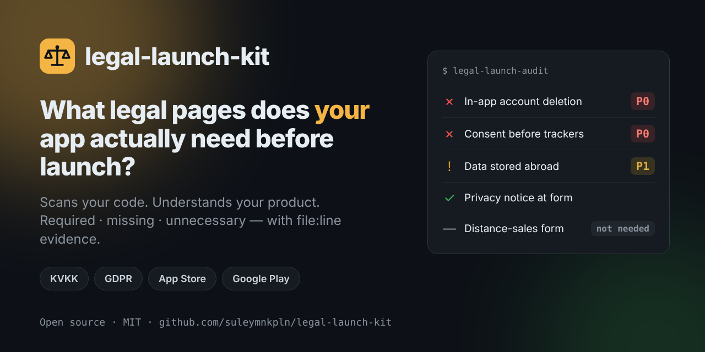
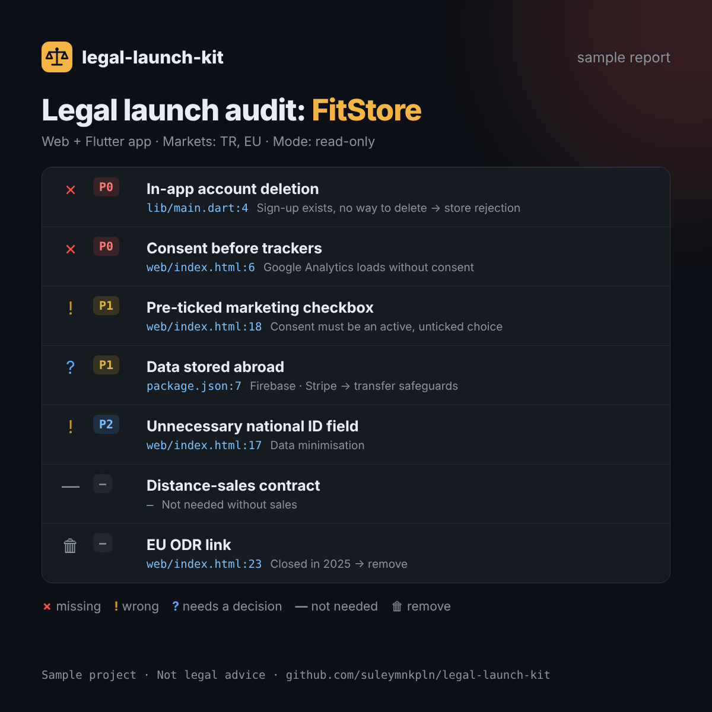

<div align="center">



**Not a generic list, but the answer for your project.** · Türkiye 🇹🇷 · EU 🇪🇺 · US 🇺🇸 · App Store · Google Play

🇹🇷 *Türkçe açıklama için:* **[README.tr.md](README.tr.md)**

[Türkçe](README.tr.md) · [Matrix](skills/legal-launch-audit/references/matrix.md) · [Checklists](checklists/en) · [Templates](templates) · [Sample report](examples/sample-report.md)

   

</div>

---

Most "legal checklist for your website" posts give everyone the same 20 items. That leads to two problems:

- **Missing what matters:** account deletion in your app, consent before trackers fire, cross-border transfer rules for Firebase, the new EU withdrawal button.
- **Adding what doesn't:** a distance-sales contract on a site that sells nothing, a forced "I give explicit consent" checkbox on a contact form, a link to an EU platform that closed in 2025.

**legal-launch-kit** solves this in three layers:

| Layer | What it is | Who it's for |
|---|---|---|
| 🧭 **Requirement matrix** | Every legal item × 7 project types, marked *Required / Conditional / Optional / Not needed / Avoid*, with official sources | Everyone |
| 🔎 **Detector** | `detect.py` scans your code (web, Flutter, Android, iOS, React Native) for trackers, ad SDKs, accounts, payments, AI, permissions and legal pages, with `file:line` evidence | Developers |
| 🤖 **Agent skill** | `legal-launch-audit` turns the scan + matrix into a prioritised audit report (✅ ❌ ⚠️ ➖ ❓ 🗑️) and, after your approval, fixes | Anyone using an AI coding agent |

## Quick start

### 1. Just the checklist (no install)

Open the checklist that matches your project:

| Project | 🇬🇧 | 🇹🇷 |
|---|---|---|
| Brochure / corporate site | [en](checklists/en/brochure-site.md) | [tr](checklists/tr/tanitim-sitesi.md) |
| E-commerce | [en](checklists/en/e-commerce.md) | [tr](checklists/tr/e-ticaret.md) |
| SaaS / subscription | [en](checklists/en/saas-subscription.md) | [tr](checklists/tr/saas-abonelik.md) |
| Mobile app | [en](checklists/en/mobile-app.md) | [tr](checklists/tr/mobil-uygulama.md) |

### 2. Scan your project

```bash
git clone https://github.com/suleymnkpln/legal-launch-kit
python3 legal-launch-kit/skills/legal-launch-audit/scripts/detect.py path/to/your-project
```

No dependencies. Read-only. Output (excerpt):

```text
| P0 | Tracking/ads code found but no consent manager. Check whether trackers fire before consent. | 1.4, 1.5 |
| P0 | Account creation found but no account-deletion path.                                       | 4.1, 1.3 |
| P1 | AdMob found without Google UMP / certified CMP.                                            | 4.7      |
| P1 | Third-party cloud/SaaS processors found. Personal data likely stored abroad …              | 1.6      |
| P2 | Link to the EU ODR platform found. The platform closed on 20 July 2025: remove it.         | 2.14     |
```

Use `--format json` for other tools.

### Block risky releases in CI

`--fail-on P0` exits with code 1 when a blocker is found (e.g. sign-up without account deletion, trackers without consent):

```yaml
# .github/workflows/legal-check.yml
name: legal-check
on: [pull_request]
jobs:
  legal:
    runs-on: ubuntu-latest
    steps:
      - uses: actions/checkout@v4
      - run: git clone --depth 1 https://github.com/suleymnkpln/legal-launch-kit /tmp/llk
      - run: python3 /tmp/llk/skills/legal-launch-audit/scripts/detect.py . --fail-on P0
```

### 3. Full audit with an AI coding agent

The skill uses the open **Agent Skills** format (`SKILL.md` + references + scripts). The same folder works without changes in every tool that supports the standard.

**One command (any supported agent):**

```bash
npx skills add suleymnkpln/legal-launch-kit
```

**Or copy the folder** into your agent's skills directory:

| Agent | Project folder | Notes |
|---|---|---|
| Claude Code | `.claude/skills/` | also `~/.claude/skills/` for all projects |
| OpenAI Codex | `.agents/skills/` | also `~/.codex/skills/` |
| GitHub Copilot (VS Code, CLI, coding agent) | `.github/skills/` or `.agents/skills/` | |
| Gemini CLI | `.gemini/skills/` or `.agents/skills/` | |
| Cursor | `.cursor/skills/` or `.agents/skills/` | if bundled scripts don't run automatically, run `detect.py` yourself and paste the output |
| Goose, OpenCode, Amp, Junie, Kiro, Windsurf, Roo Code… | usually `.agents/skills/` | check your tool's docs |

```bash
cp -r legal-launch-kit/skills/legal-launch-audit your-project/.agents/skills/
```

> The detector needs Python 3.9+. Agents that can run terminal commands (Claude Code, Codex, Gemini CLI, Copilot CLI…) use it automatically. In chat-only environments the skill falls back to searching the code itself, which works but is less thorough.

Then ask your agent:

> Audit this project for launch: markets Türkiye and EU, we sell digital subscriptions.

You get the report described in [report-format.md](skills/legal-launch-audit/references/report-format.md). See a full [sample report](examples/sample-report.md).

<p align="center"></p>

## What it covers

<details>
<summary><b>🇹🇷 Türkiye</b></summary>

- KVKK:
  - privacy notice (*aydınlatma*) vs. explicit consent (*açık rıza*), including the common forced-consent mistake,
  - cookie guidelines,
  - transfers abroad under the 2024 amendment (standard contract + 5-business-day notification),
  - VERBİS thresholds (2025 decisions).
- E-commerce: Law 6563, imprint (*künye*), ETBİS, order process.
- Distance sales: pre-contract form, distance-sales contract, 14-day withdrawal right, the 2026 changes (return shipping cost, mediation notice).
- Advertising regulation amendments in force since 1 Aug 2026: verified-buyer reviews, 10-day discount reference price, influencer labels, AI disclosure in ads, green claims.
- İYS commercial messages.
- Law 5651 for user-generated content.
- **Under-15 social network ban (Law 7578, regulation in force 1 Nov 2026):** e-Devlet age verification, protected mode for ages 15–17, parental controls. No user threshold, so it can apply to small apps with social features.

</details>

<details>
<summary><b>🇪🇺 European Union</b></summary>

- GDPR: notice, legal bases, rights, DPAs, transfers, Art. 27 representative, DPIA triggers.
- ePrivacy cookie consent.
- Consumer Rights Directive, including the **withdrawal button (since 19 June 2026)**.
- Omnibus price-reduction and review rules; the ODR link **removal** (2025).
- European Accessibility Act (since 28 June 2025) with the microenterprise exemption.
- Digital Services Act (notice and action, trader traceability).
- **AI Act Art. 50 transparency (since 2 Aug 2026)**.
- **Cyber Resilience Act:** apps are in scope; vulnerability and incident reporting since 11 Sept 2026.
- UK Online Safety Act note.

</details>

<details>
<summary><b>🇺🇸 United States</b></summary>

CCPA/CPRA thresholds and opt-outs (GPC), CalOPPA, state privacy laws, amended COPPA (compliance since 22 Apr 2026), ROSCA and auto-renewal laws (click-to-cancel status), CAN-SPAM/TCPA.

</details>

<details>
<summary><b>📱 App Store & Google Play</b></summary>

- Privacy labels / Data safety, iOS privacy manifest.
- Account deletion (in-app + web).
- Permissions and App Tracking Transparency.
- EU trader status (DSA), certified CMP for AdMob in the EEA/UK/CH.
- Subscriptions, new Apple age ratings, Kids and UGC rules.
- Android developer verification (sideloading included).

</details>

## It understands what your product *does*

Legal needs follow from purpose, not from the tech stack. The skill first builds a short product summary from your README, store listing text, package descriptions and main screens, then checks it against [sector rules](skills/legal-launch-audit/references/sectors.md):
- health and fitness,
- finance and crypto,
- kids,
- social and dating,
- marketplace,
- delivery and booking,
- location tracking,
- gambling,
- AI,
- IoT,
- restricted goods.

It asks you to confirm the summary, then explains every finding in terms of **your** feature ("your app lets users follow each other, so…") with a concrete fix.

## How it decides "required" vs. "not needed"

Each item in the [matrix](skills/legal-launch-audit/references/matrix.md) has a **trigger**. Some examples:

| Item | Trigger | No trigger → |
|---|---|---|
| Cookie consent banner | Non-essential cookies/SDKs run | Not needed. Prefer removing trackers over adding a banner |
| ETBİS registration (TR) | You sell through your **own** site/app | Not needed if you only sell via a Turkish marketplace |
| EU accessibility (EAA) | B2C e-commerce in the EU | Microenterprises (<10 staff, ≤ €2M) are exempt for services |
| CCPA rights page | Above California thresholds | Most indie projects are below; still post a privacy policy (CalOPPA) |
| Account deletion | Users can sign up in your app | Not needed for apps without accounts |

## Project structure

```text
skills/legal-launch-audit/
├── SKILL.md                 # agent instructions
├── references/              # matrix + per-market law notes with sources and "Last verified" dates
└── scripts/detect.py        # zero-dependency scanner
checklists/{en,tr}/          # human checklists per project type
templates/{en,tr}/           # skeleton legal texts with placeholders (lawyer review required)
examples/sample-report.md    # what an audit looks like
tests/                       # detector tests + SKILL.md validation (CI)
```

## Keeping it current

Laws change. Every reference file has a **Last verified** date, and every rule links its official source.

- Found something outdated? Open a [law update issue](.github/ISSUE_TEMPLATE/law-update.md) with the source.
- Want to add your country? See [CONTRIBUTING.md](CONTRIBUTING.md). New markets are a single reference file plus matrix rows.

## ⚠️ Disclaimer

This project is **not legal advice** and does not create a lawyer-client relationship. It helps you find gaps and ask better questions. Requirements depend on facts that code cannot show (company type, contracts, registrations, revenue). Have a qualified lawyer review your legal texts before publishing. Tax, company registration and sector licences are out of scope.

## License

[MIT](LICENSE). Use it, fork it, ship it. A ⭐ helps others find it.
