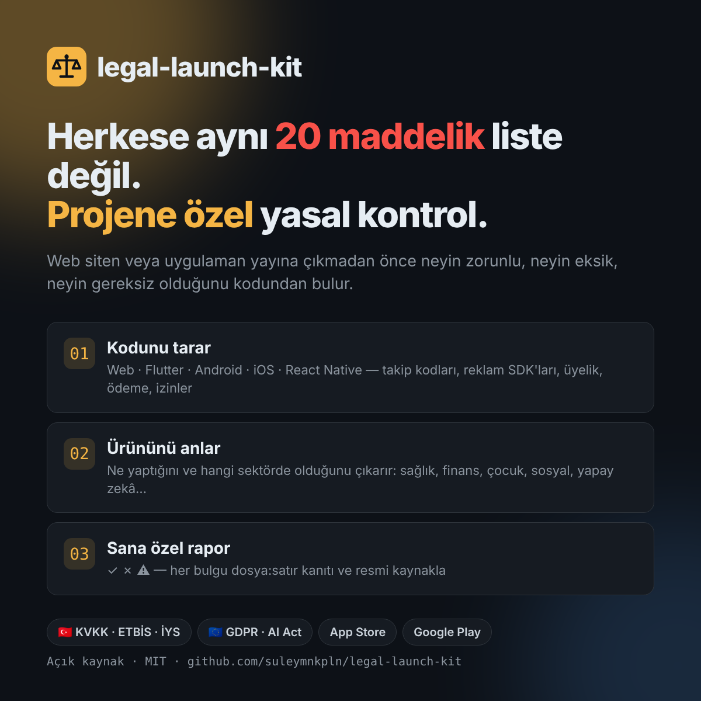
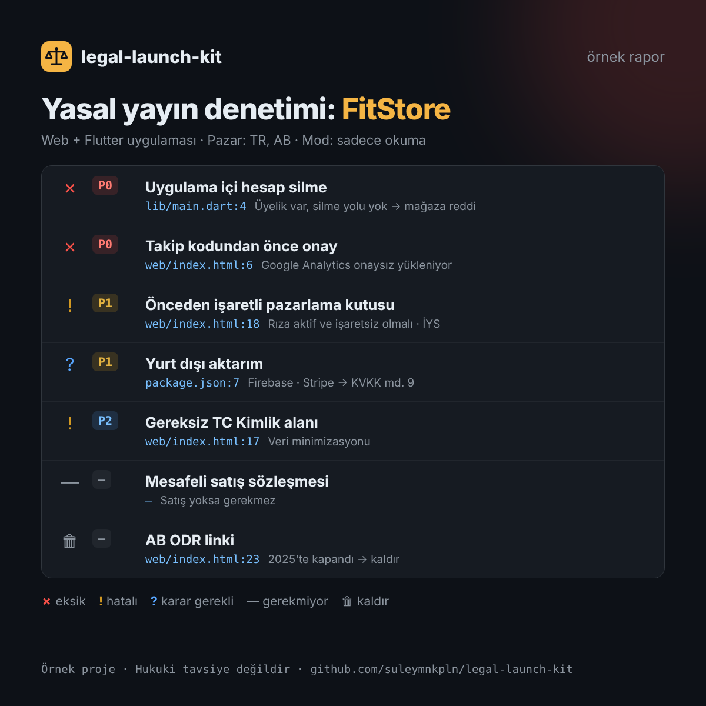

<div align="center">

# ⚖️ legal-launch-kit

**Web siten veya uygulaman yayına çıkmadan önce yasal olarak *gerçekten* hangi sayfalara ve özelliklere ihtiyaç duyuyor? Genel bir liste değil, senin projen için cevap.**

Türkiye 🇹🇷 · AB 🇪🇺 · ABD 🇺🇸 · App Store · Google Play

[English](README.md) · [Matris](skills/legal-launch-audit/references/matrix.md) · [Kontrol listeleri](checklists/tr) · [Şablonlar](templates) · [Örnek rapor](examples/sample-report.md)

</div>

---

İnternette dolaşan "sitende olması gereken 20 yasal madde" listeleri herkese aynı şeyi söyler. Bu da iki soruna yol açar:

- **Asıl eksik atlanır:** uygulama içi hesap silme, takip kodlarından önce çerez onayı, Firebase kullanıyorsan yurt dışına aktarım kuralları, AB'nin yeni "cayma butonu".
- **Gereksiz şeyler eklenir:** hiçbir şey satmayan siteye mesafeli satış sözleşmesi, iletişim formuna zorunlu "açık rıza veriyorum" kutusu, 2025'te kapanmış AB platformuna link.

**legal-launch-kit** bunu üç katmanda çözer:

| Katman | Ne | Kimin için |
|---|---|---|
| 🧭 **Gereklilik matrisi** | Her yasal madde × 7 proje tipi: *Zorunlu / Koşullu / Önerilen / Gereksiz / Kaçın*, resmi kaynaklarıyla | Herkes |
| 🔎 **Tarayıcı** | `detect.py` kodunu (web, Flutter, Android, iOS, React Native) tarar. Takip kodlarını, reklam SDK'larını, üyeliği, ödemeyi, yapay zekâyı, izinleri ve yasal sayfaları `dosya:satır` kanıtıyla listeler | Geliştiriciler |
| 🤖 **Agent skill** | `legal-launch-audit` taramayı ve matrisi öncelik sıralı bir denetim raporuna (✅ ❌ ⚠️ ➖ ❓ 🗑️) çevirir, onay verirsen düzeltir | Yapay zekâ kod asistanı kullananlar |

<p align="center">
  
  
</p>

## Hızlı başlangıç

### 1. Sadece kontrol listesi (kurulum yok)

| Proje | Liste |
|---|---|
| Tanıtım / kurumsal site | [tanitim-sitesi.md](checklists/tr/tanitim-sitesi.md) |
| E-ticaret | [e-ticaret.md](checklists/tr/e-ticaret.md) |
| SaaS / abonelik | [saas-abonelik.md](checklists/tr/saas-abonelik.md) |
| Mobil uygulama | [mobil-uygulama.md](checklists/tr/mobil-uygulama.md) |

### 2. Projeni tara

```bash
git clone https://github.com/suleymnkpln/legal-launch-kit
python3 legal-launch-kit/skills/legal-launch-audit/scripts/detect.py proje/klasorun
```

Bağımlılık gerektirmez ve sadece okur, hiçbir dosyayı değiştirmez. Çıktıyı başka araçlarda kullanmak için `--format json` ekle.

**CI'da riskli yayını durdur:** `--fail-on P0` kritik bir eksik bulduğunda hata koduyla çıkar. Örneğin üyelik var ama hesap silme yok, ya da onaysız takip kodu çalışıyor. GitHub Actions'ta bu, pull request'in kırmızı yanması demek. Örnek iş akışı [README.md](README.md#block-risky-releases-in-ci) içinde.

### 3. Yapay zekâ asistanıyla tam denetim

Skill, açık **Agent Skills** formatında (`SKILL.md` + referanslar + betik). Aynı klasör, bu standardı destekleyen her araçta değişiklik yapmadan çalışır.

**Tek komutla kurulum:**

```bash
npx skills add suleymnkpln/legal-launch-kit
```

**Veya klasörü kopyala:**

| Araç | Klasör | Not |
|---|---|---|
| Claude Code | `.claude/skills/` | tüm projeler için `~/.claude/skills/` |
| OpenAI Codex | `.agents/skills/` | ayrıca `~/.codex/skills/` |
| GitHub Copilot (VS Code, CLI) | `.github/skills/` veya `.agents/skills/` | |
| Gemini CLI | `.gemini/skills/` veya `.agents/skills/` | |
| Cursor | `.cursor/skills/` veya `.agents/skills/` | betik otomatik çalışmazsa `detect.py`'yi elle çalıştırıp çıktısını yapıştır |
| Goose, OpenCode, Amp, Junie, Kiro, Windsurf, Roo Code… | genelde `.agents/skills/` | aracın dokümanına bak |

> Tarama betiği Python 3.9+ ister. Terminal komutu çalıştırabilen araçlar (Claude Code, Codex, Gemini CLI, Copilot CLI…) betiği kendisi çalıştırır. Sadece sohbet edilen ortamlarda skill kodu kendisi arar. Bu yöntem de çalışır ama daha az ayrıntılı sonuç verir.

Sonra asistana şunu yaz:

> Bu projeyi yayın öncesi yasal açıdan denetle. Hedef pazar Türkiye ve AB, dijital abonelik satıyoruz.

## Kapsam (özet)

**Türkiye**
- KVKK: aydınlatma ile açık rıza farkı (zorla rıza hatası), çerez rehberi, 2024 sonrası yurt dışı aktarım (standart sözleşme + 5 iş günü bildirim), VERBİS eşikleri (2025 kararları).
- E-ticaret: 6563, künye, ETBİS.
- Mesafeli satış: 2026 değişiklikleri (iade kargo, arabuluculuk bilgisi).
- 1 Ağustos 2026'da yürürlüğe giren reklam yönetmeliği değişiklikleri: yorumlar, 10 günlük indirim referansı, influencer etiketi, reklamda yapay zekâ beyanı.
- İYS ve 5651.
- **15 yaş altı sosyal ağ yasağı** (7578 sayılı Kanun, yönetmelik 1 Kasım 2026'da yürürlüğe girdi): e-Devlet ile yaş doğrulama, 15–17 yaş için korumalı mod, ebeveyn kontrolü. Kullanıcı sayısı eşiği yok.

**AB**
- GDPR ve çerez onayı.
- 19 Haziran 2026'dan beri zorunlu **cayma butonu**.
- ODR linkinin **kaldırılması** (2025).
- Erişilebilirlik Yasası (mikro işletme istisnası ile).
- DSA.
- **Yapay Zekâ Yasası md. 50 şeffaflık (2 Ağustos 2026'dan beri)**.
- **Siber Dayanıklılık Yasası (CRA):** mobil uygulamaları da kapsıyor, açık bildirimi 11 Eylül 2026'dan beri zorunlu.

**ABD:** CCPA eşikleri, CalOPPA, eyalet yasaları, güncellenen COPPA, abonelik/otomatik yenileme kuralları.

**Mağazalar**
- Gizlilik etiketleri ve Data safety.
- Hesap silme (uygulama içi + web).
- İzinler ve ATT.
- AB "trader" statüsü.
- AdMob için sertifikalı CMP.
- Yeni Apple yaş derecelendirmeleri.
- Android geliştirici doğrulaması.

## Ürününün ne yaptığını anlıyor

Yasal ihtiyaçlar kullandığın teknolojiden değil, ürünün amacından doğar. Skill önce README, mağaza açıklaması, paket açıklamaları ve ana ekranlardan kısa bir ürün özeti çıkarır. Sonra bu özeti [sektör kurallarıyla](skills/legal-launch-audit/references/sectors.md) karşılaştırır:
- sağlık ve fitness,
- finans ve kripto,
- çocuk,
- sosyal ve flört,
- pazaryeri,
- teslimat ve rezervasyon,
- konum takibi,
- şans oyunları,
- yapay zekâ,
- IoT,
- kısıtlı ürünler.

Özeti sana onaylatır. Ardından her bulguyu **senin** özelliğine bağlayarak açıklar ("uygulamanda kullanıcılar birbirini takip edebiliyor, bu yüzden…") ve somut bir çözüm önerir.

## "Zorunlu" mu "gereksiz" mi nasıl karar veriyor?

[Matristeki](skills/legal-launch-audit/references/matrix.md) her maddenin bir **tetikleyicisi** var:

| Madde | Tetikleyici | Tetikleyici yoksa |
|---|---|---|
| Çerez onay bandı | Zorunlu olmayan çerez/SDK çalışıyor | Gerekmez. Bant eklemek yerine takip kodunu kaldırmak daha iyi |
| ETBİS kaydı | **Kendi** site/uygulaman üzerinden satış | Sadece yerli pazaryerinde satıyorsan gerekmez |
| Açık rıza metni | Hukuki dayanak rıza (pazarlama, zorunlu olmayan çerez…) | İletişim formuna zorunlu açık rıza kutusu koymak **hatadır** |
| Mesafeli satış + ön bilgilendirme | Tüketiciye uzaktan satış | Satış yoksa gereksiz kalabalık |
| Hesap silme | Uygulamada üyelik var | Üyelik yoksa gerekmez |

## Güncel tutma

Mevzuat değişir. Her referans dosyasında **Last verified** tarihi, her kuralda resmi kaynak linki var.

- Güncelliğini yitirmiş bir madde gördüysen kaynağıyla birlikte [issue aç](.github/ISSUE_TEMPLATE/law-update.md).
- Kendi ülkeni eklemek istiyorsan [CONTRIBUTING.md](CONTRIBUTING.md) dosyasına bak.

## ⚠️ Sorumluluk reddi

Bu proje **hukuki tavsiye değildir**. Eksikleri bulmana ve doğru soruları sormana yardım eder. Kodun gösteremediği olgulara (şirket türü, sözleşmeler, kayıtlar, ciro) bağlı yükümlülükler vardır. Yasal metinlerini yayınlamadan önce bir hukukçuya kontrol ettir. Vergi, şirket kuruluşu ve sektörel izinler kapsam dışıdır.

## Lisans

[MIT](LICENSE). İşine yaradıysa bir ⭐ başkalarının da bulmasına yardım eder.
